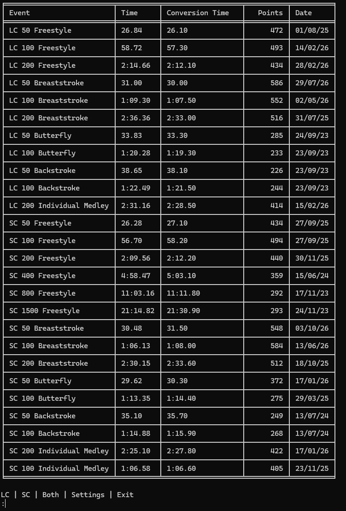
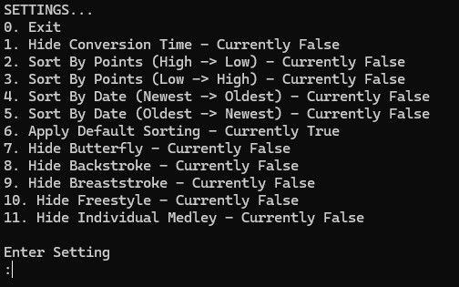

A Python project for retrieving and organising swimming personal-best (PB) data from the Swim England website (https://www.swimmingresults.org/individualbest/).

## Overview:
This project was created to make it easier to access and work with swimming personal-best information. It uses Python to handle the process of retrieving and processing swimming data and then organising it and outputting it to the user. This solves a real problem for me because I am a competitive swimmer and I am constantly viewing my PBs and wishing that the Swim England website was better.

## Features:
- Retrieves swimming personal-best data from Swim England using a membership code.
- Uses Python to process the retrieved information.
- Allows the user to filter and sort results
- Outputs results in a table to make them easily readable for the user.

## Screenshots:

Results Table:

Settings:

## What I learned:
Developing this project helped me improve my Python programming skills and understand the challenges involved in retrieving and processing data from an external source. It also gave me experience developing a practical tool to solve a real specific problem.

## Requirements:
- Python 3.
- A stable internet connection.

## Running the project:
1. Clone or download this repository.
2. Install the required dependencies using 'python -m pip install -r requirements.txt'.
3. Run the main.py script.

To find someones Swim England membership number just go to https://www.swimmingresults.org/individualbest/ and search for them and then their membership number will be at the top.

## Potential Future Improvements:
- Improve error handling.
- Add comparisons between multiple swimmers.
- Make setup and usage easier for less experienced users.
